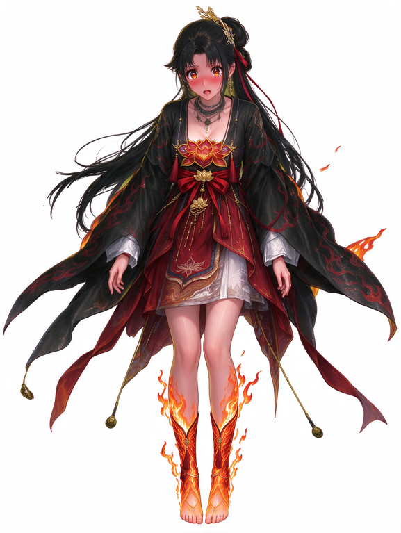
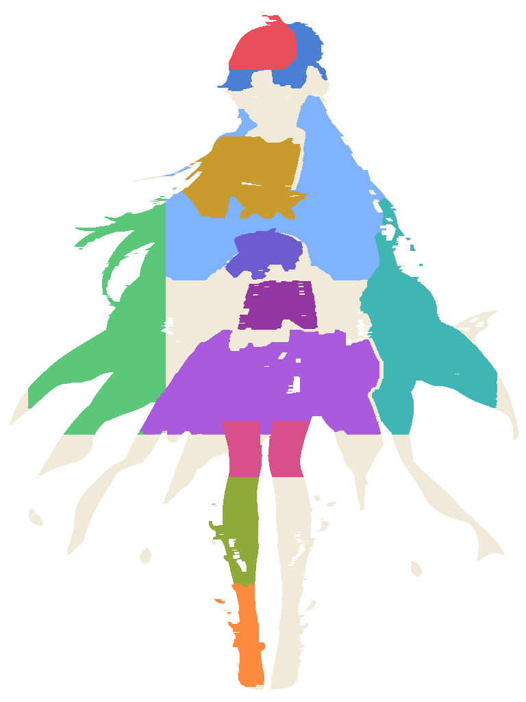
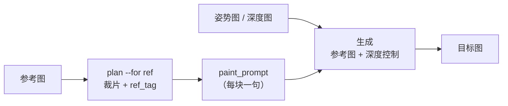
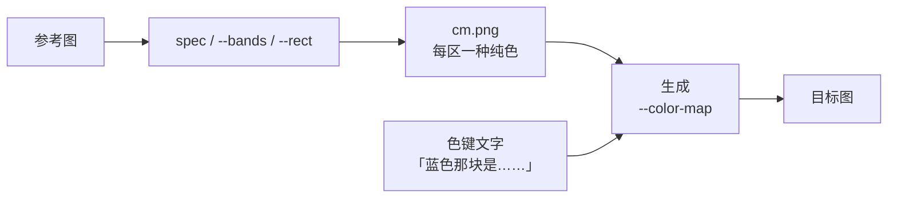
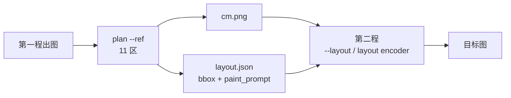
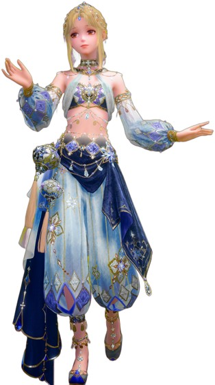
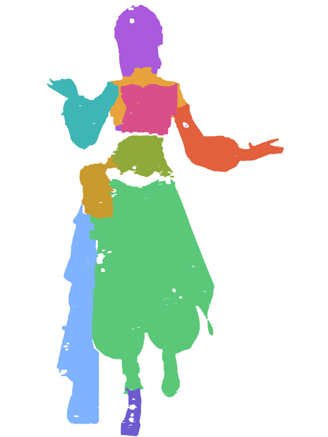
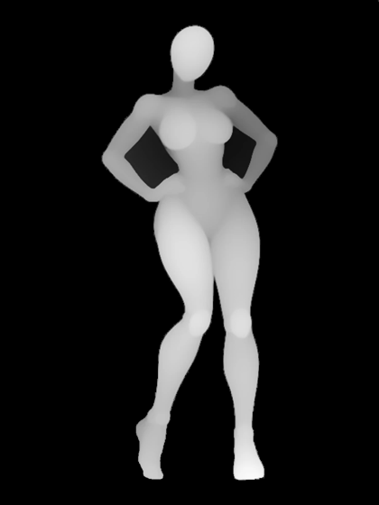
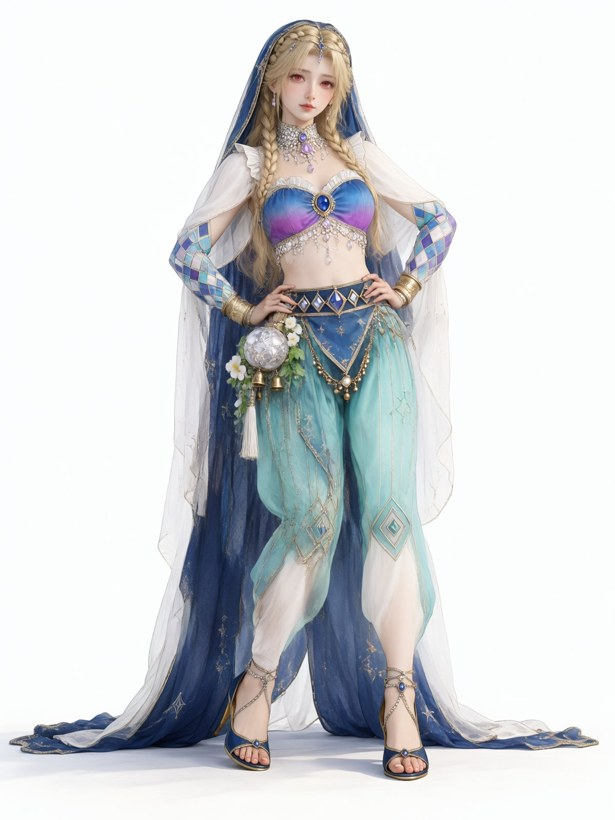
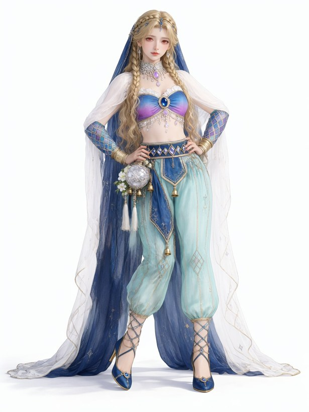

# GrabTag

[English](README.md) · **简体中文**

**把一张参考图切成区域、逐块打标，让模型明确知道每句话对应哪一块。**

GrabTag 把一张参考图变成"分区可控"的生成输入：切区、打标，输出区域 ID 色图与 `layout.json`，供 MOSS-Image / ComfyUI 使用。纯 Python、纯 CPU、不含模型权重。四个命令行子命令：`plan`/`build`、`colormap`、`depth-colormap`、`chroma`（绿幕抠像）。

<table>
<tr>
<td width="50%"></td>
<td width="50%"></td>
</tr>
<tr>
<td><sub><b>① 你手里有的</b>：一张插画，所有细节都是隐含的，提示词只能含糊地指过去</sub></td>
<td><sub><b>② <code>plan</code> 给你的</b>：同一张图被画成分区色图，每种纯色是一个区，每个区各自拿到一条独立指令和一个框</sub></td>
</tr>
</table>

*上图是作者为本项目提供的示例素材；右侧色图由 `plan` 配合 12 区 spec 直接产出（金羽簪、外袍、胸口莲、腰封、金扣、裙、下摆、双袖、腿、靴……）。*

大多数"参考图工作流"是把一张图丢给模型，然后祈祷它别丢细节。GrabTag 走反方向：**先把参考图切成有名字的区域，给每个区域写一条指令，再给每条指令一个框** —— 模型得到的是"这句话属于这个框"，而不是"这张图里某个地方有一朵莲花"。

不需要模型权重、不含第三方美术素材、不绑定框架：Python + Pillow，OpenCV / scipy / SAM 都是可选项。

---

## 三种用法

同一个工具，三种输入形状。变的只有一件事：**几何走哪条通道**。

### ① 参考图 + 姿势图 —— 文字与深度扛几何



深度图锁轮廓，提示词说清每一段是什么；全程不涉及色图。

### ② 色图 —— 像素扛几何



色图回答**在哪里**，色键那句话回答**是什么**；缺一个都不成。

### ③ 两者结合 —— 色图管落位，每区一句话管材质



<table>
<tr>
<td width="33%"></td>
<td width="33%"></td>
<td width="34%"></td>
</tr>
<tr>
<td><sub><b>① 你手里有的</b>：一张服装卡</sub></td>
<td><sub><b>② 同一张卡，被切成区</b><br/><code>plan --ref</code> 把每个部件涂成一块纯色</sub></td>
<td><sub><b>③ 一个姿势</b>：转成深度图，当结构控制</sub></td>
</tr>
</table>

<table>
<tr>
<td width="33%"></td>
<td width="33%"></td>
<td width="34%"></td>
</tr>
<tr>
<td><sub><b>④ 第一程</b>：① + ③，还没上色图</sub></td>
<td><sub><b>⑤ 把第一程的产出切成 11 区</b><br/><code>examples/ice_11.json</code></sub></td>
<td><sub><b>⑥ 第二程</b>：色图管落位，每区一句指令管材质</sub></td>
</tr>
</table>

*上面每一格都来自同一次真实运行。* 同一个 `plan` 在这里干了两件不同的事：**②** 把服装卡变成有名字的区（好让你逐块写 `ref_tag`），**⑤** 把已渲染的图变成落位区（好让第二程知道每句 `paint_prompt` 属于哪里）。中间那张 **④** 是"只给参考图 + 深度姿势、完全不上色图"的结果 —— ⑤ 补的就是这段差。

*① ② ③ 做过裁切与缩放；④ ⑤ 是这次运行自己的输出，仅缩放。*

*上面每一格都来自同一次真实运行。* 服装卡和姿势就是真实输入：姿势转成深度图当结构控制，服装卡负责外观，两者合成 ③；随后 `plan --ref` 从 ③ 里切出 11 个区，写出 `cm.png`（④）和每区一句 `paint_prompt`（`examples/ice_11.json`），第二程据此精修出 ⑤。为控制篇幅，人像做了裁切，胸部打码。

## 为什么需要它

两条通道同时抵达一个"分区感知"的图像模型，把它们搞混是最常见的故障：

| 通道 | 载体 | 回答什么 | 不能表达 |
|---|---|---|---|
| **文字** | `ref_tag`（参考侧）、`paint_prompt`（生成侧）、`summary.text` | 这块**是什么** / 这里**画什么** | 位置——文字本身没有几何 |
| **像素** | `cm.png`：区域 ID 色图 | 每块在**哪里** | 这块是什么材质 |
| **两者** | `layout.json` | 哪句话属于哪个框 | —— 它只把上面两者拼起来 |

GrabTag 的职责就是把这几份文件正确地做出来；下游怎么消费是你自己的事。想先通读机制（含搞反时的六种症状）：[`docs/MECHANISM.md`](docs/MECHANISM.md)。

---

## 安装

```bash
git clone <本仓库> && cd grabtag

pip install -e .            # 核心：numpy + Pillow，四个子命令都能跑
pip install -e ".[mask]"    # + opencv-python、scipy -> --masker grabcut / --fit / --min-area
pip install -e ".[sam]"     # + torch、segment-anything -> --masker sam-auto
```

Python 3.9+。除非用 SAM 且走 CUDA，否则不需要显卡。

验证：

```bash
grabtag --help
```

## 三分钟上手

```bash
python examples/make_demo.py examples/demo.png     # 合成一张可用示例图（不用外部素材）

python grabtag.py plan --ref examples/demo.png \
       --spec examples/demo_spec.json --out build/demo   # ① 切区 + 上色 + 写清单

# ② 打开 build/demo/montage.png，看每一格裁片，
#    把 ref_tag / paint_prompt 填进 build/demo/regions.json

python grabtag.py build --dir build/demo           # ③ 导出分区条件
```

```
build/demo/
├─ regions.json        你要填的那份（每区 ref_tag + paint_prompt）
├─ tags.json           参考侧标签（给写提示词的人看）
├─ cm.png              区域 ID 色图（像素通道）
├─ montage.png         带序号的裁片（给眼睛 / 给视觉模型看）
├─ layout.json         {summary.text, items[{label, paint_prompt, bbox}]}
└─ layout.audit.json   同样内容 + 每区覆盖体检
```

## 四份产物，逐个说清

| 文件 | 键 | 谁消费 |
|---|---|---|
| `regions.json` | `id, color, rect, span, crop, ref_tag, paint_prompt, priority, kept, loss_hi, masker, own_px` | 你填，然后 `build` 读 |
| `tags.json` | `ref, size, summary, tags[{name, ref_tag, crop, color, area}]` | 文字侧：把这些短语写进提示词 |
| `layout.json` | `summary{text}` + `items[{label, paint_prompt, bbox}]` | 像素+文字侧：分区感知的采样器 |
| `layout.audit.json` | 同上，另加 `_region / _kept / _warn` | 只用于排查 |

`bbox` 是 **`yxyx` 像素、以画布中心为原点**，即 `[y0, x0, y1, x1]`。如果你的模型要 `xyxy`、归一化浮点或左上角像素，在边界处转一次即可——换算逻辑在 `grabtag/core/layout.py::pixel_bbox`。

> **字段名（2026-11-06 起）**：参考侧标签是 `ref_tag`（旧 `tag`），生成侧区域指令是 `paint_prompt`（旧 `caption`），全局一句话是 `summary.text`（旧 `summary.caption`）。代码**读旧名、只写新名**，旧工作目录可以继续加载。

---

## 命令参考

### `plan` —— 定义区域并上色

| 参数 | 含义 |
|---|---|
| `--ref IMG` | 参考图（任意尺寸，按 `--size` 归一） |
| `--bands N` | 等分横切 N 段（最快的基线） |
| `--band a:b --band c:d …` | 自己指定分数切点，如 `--band 0.0:0.30` |
| `--rect name=x0,y0,x1,y1 …` | 自由框 |
| `--spec FILE` | JSON 清单：`{name, rect, color?, ref_tag?, paint_prompt?, seed?, priority?, object?, aliases?, requires?, no_clamp?, sam?}` |
| `--for both\|ref\|layout` | `ref` 只出裁片与 tags；`layout` 只出色图；默认两者都出 |
| `--masker grabcut\|sam-auto` | 把每个区细化到真实轮廓（要 `[mask]` / `[sam]`） |
| `--fit bg\|depth` | 只给人物轮廓上色，保留发丝缝隙与腿间空隙 |
| `--x-inset 0.10` | 收窄色带；**全宽带会被读成好几个人** |
| `--max-items 20` | 物件数上限（一对袖子用 `object` 合并算一件） |
| `--lint-strict` | `paint_prompt` 自检不达标时以退出码 2 结束 |

`plan` 会打印**覆盖体检**——`kept`（这个区在最终色图里剩下多少）与 `loss_hi`（损失里有多少来自同级或更高优先级的区）——并拒绝重复颜色，因为 layout 导出是按颜色归并的。

### `build` —— 导出分区条件

```bash
python grabtag.py build --dir build/demo [--sort small|area|y] [--quiet]
```

任何区还缺 `paint_prompt` 时直接失败退出；同时会按 `ref_tag` 补写 `tags.json`，因此"自动切区 → 手填 → build"这条链也有参考侧产物。`--sort small` 把小物件排在前面——它们本来就更容易被吃掉。

### `colormap` / `depth-colormap` / `chroma`

```bash
# 由深度图驱动的横带分区
python grabtag.py colormap --depth pose_depth.png --bands 4 --out cm.png
# 只给主体上色（需要深度背景干净）
python grabtag.py colormap --depth pose_depth.png --bands 4 --subject --out cm.png

# 深度切片：seed | band | front | plateau
python grabtag.py depth-colormap --depth pose_depth.png --mode front --out cm.png
# 一次出多区：--region x,y,mode,tol,color（可重复）

# 绿幕抠像 -> RGBA + 棋盘格预览
python grabtag.py chroma shot.jpeg --rotate 90 --metric green --out rgba.png --preview prev.png
```

色图**不是一张画**：每种纯色都是区域 ID，提示词必须说明这个颜色意味着什么（`the #7fb3ff area is a faceted ice shell`）。上色顺序是 `(priority, −area)`，所以十个小挂件能活过一件大袍子。

---

## 环境变量

| 变量 | 被谁读 | 含义 |
|---|---|---|
| `GRABTAG_SAM_CKPT` | `--masker sam-*` | `sam_vit_b_*.pth` 的路径（默认当前目录的 `sam_vit_b_01ec64.pth`） |
| `GRABTAG_INPUT_DIR` | `plan` | 下游 loader 期望的目录；默认 `./ComfyUI/input`，目录不存在就跳过同步 |

## 在 ComfyUI / MOSS-Image 里用

* 把 `cm.png` 放到 loader 看得见的地方——图像 loader 通常只接受它自己 `input/` 里的文件名，所以拷进去、传裸文件名。
* 色图别太大：16×16 patch 的 VAE 意味着 `(w/16)·(h/16) ≤ 4096`，也就是 ≤ 1024×1024。
* `layout.json` 是给分区感知采样器（MOSS-Image 的 layout encoder，或你自己的节点）用的，**它不是图片**——把它塞进提示词字段，模型只会读到一段 JSON 文本。

## 实战里的六条（都是踩出来的）

1. **一个区 = 一个物件。** 没给某个部件单独开区，模型就会自己编一个。
2. **颜色必须唯一。** 两个区 RGB 相同会被并成一项。
3. **`paint_prompt` 必须写落点。** `a lotus ornament` 可能跑到头发上；`a lotus ornament printed flat on the chest, between the collarbones` 不会。
4. **全身像 ~12 区是甜点。** 超过 ~16 区，小物件开始消失。
5. **窄框不会把人切成几个人，全宽带会。** 横带模式请把 `--x-inset` 控制在 `0.08–0.12`。
6. **色图管几何，指令管材质。** 改文字永远改不动轮廓——要改形状就重画色图。

## 开发

```bash
pip install -e ".[mask]"
python examples/make_demo.py /tmp/demo.png
python grabtag.py plan --ref /tmp/demo.png --spec examples/demo_spec.json --out /tmp/gt
python grabtag.py build --dir /tmp/gt
```

CI 在 Python 3.9 / 3.11 / 3.12 上就跑这几步 —— 见 `.github/workflows/ci.yml`。提交前请读 [`CONTRIBUTING.md`](CONTRIBUTING.md)；改动记录见 [`CHANGELOG.md`](CHANGELOG.md)。

## 许可

MIT —— 见 [`LICENSE`](LICENSE)。第三方说明见 [`NOTICE.md`](NOTICE.md)。

---

*仓库里的示例图由 `examples/make_demo.py` 生成，或由作者提供用于文档说明；不含任何第三方美术素材与模型权重。英文版见 [`README.md`](README.md)。*
