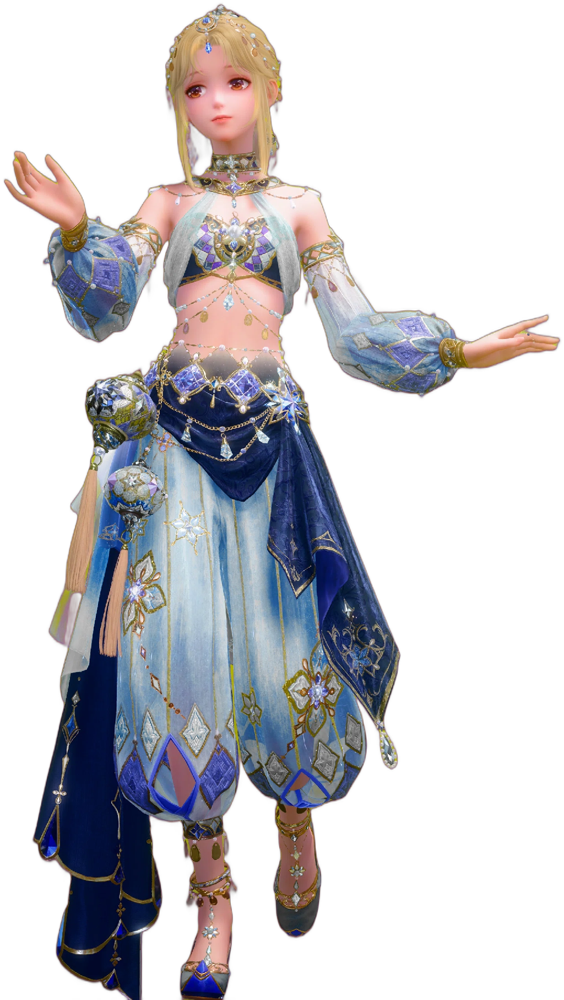
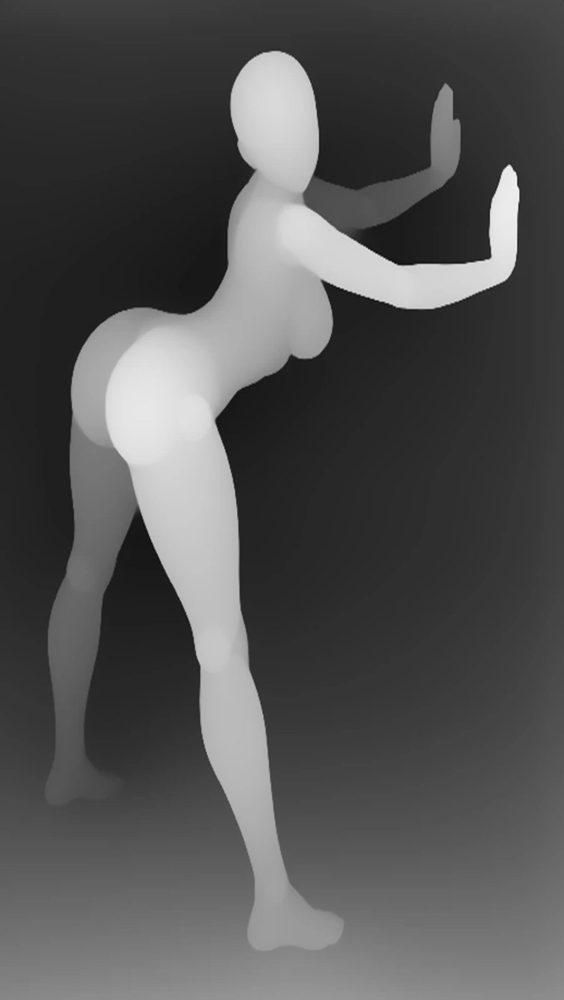
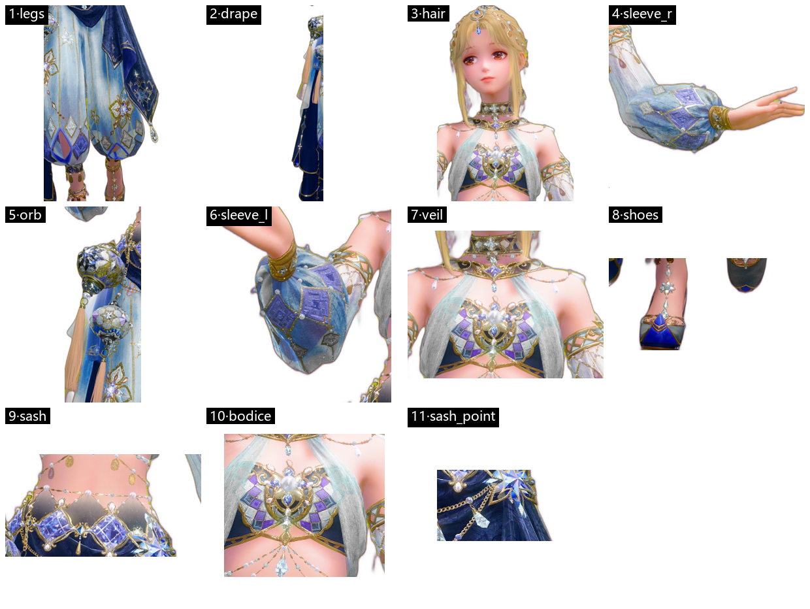
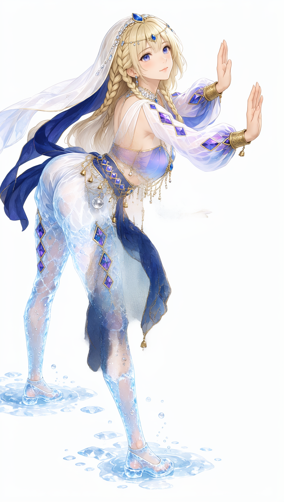

# Case V2 — 单段 · 参考同尺寸 · 纹样继承

> 这份是**示例档案**，只记录"这一张是怎么出来的"。
> 机制与参数的完整说明见 [`../moss-image-edit-integration.md`](../moss-image-edit-integration.md)；
> 服务端三道 OOM 防线见 [`../moss-ref-oom-guards.md`](../moss-ref-oom-guards.md)。

| 项 | 值 |
|---|---|
| 输出 | `result.png`（1024×1808） |
| 通道 | `--edit-format Moss-Image-Edit`（参考走 **VAE latent**，不是 vision token） |
| 段数 | **单段**（无二次精修） |
| 耗时 | 92.6 s（8 GB 笔记本 4060） |
| 里程碑 | 结构 / 纹样 / 姿态 三项同时成立的第一张 |

---

## 1. 输入

### 1.1 参考图（外观真值）



- 原始 1538×2724，带 alpha；预处理：alpha 合成到**白底** → `NEAREST` 缩到短边 **1024** → 1024×1814。
- 这里必须用 `NEAREST`（保边界锐度），不能用 `LANCZOS/BICUBIC`——插值会把纹样糊掉。

### 1.2 姿势图（深度）



- 原始 960×1280 深度图；`BICUBIC` 缩放到与输出同尺寸 1024×1814。
- 深度只提供**姿态骨架**，不提供布料体积——见 §4。

### 1.3 分区与 tag（GrabTag 产出）

`plan --for ref` 在参考图上跑 SAM，切出 11 个部件并逐个打 `ref_tag`：



颜色分区图（区域 ID，无语义）：


| id | 颜色 | rect（0–1） | ref_tag |
|---|---|---|---|
| bodice | `#6f5fb0` | 0.32, 0.19, 0.56, 0.31 | 露腰抹胸 + 菱格 + 金饰 |
| sash | `#2b3f7a` | 0.25, 0.31, 0.59, 0.41 | 腰封 + 金铃 + 垂链 |
| sleeve_r | `#5c9bd1` | 0.56, 0.23, 0.99, 0.44 | 蓝白菱格灯笼袖 + 紫菱 + 金环 |
| legs | `#cfe6f2` | 0.235, 0.45, 0.725, 0.905 | 冰晶裤腿 + 紫菱 |
| veil | `#e8f2f8` | 0.02, 0.0, 0.62, 0.30 | 白纱披 + 深藏蓝披纱 |
| hair / orb / shoes / … | | | |

> 本案例**单段生成不读 tag/色图**（`--edit-format Moss-Image-Edit` 只看参考与提示词）。
> 分区与 tag 在这里的用途是：**它是 V3 的前提**——将来做"只让被提到的部件参与"时，靠的就是这张表。

---

## 2. 命令

```powershell
# 服务端（重启 ComfyUI 前设置，必须进服务进程，设在调用端无效）
$env:MOSS_REF_POOL = '2'        # 参考 KV 2×2 池化：7232 → 1792 tok，OOM 的主防线
$env:MOSS_REF_ALIGN = '1'       # 参考 token 与画布共享坐标系（纹样能进来的关键）
C:\MOSS-Deploy\start-comfyui-moss-8190.bat
```

```powershell
python C:\MOSS-Deploy\moss_run.py --port 8190 `
  --image ref_s2_1024w.png:raw `
  --edit-format Moss-Image-Edit `
  --depth-map dep_sx08_1024.png --control-strength 0.75 `
  --no-dype `
  --w 1024 --h 1814 `
  --no-fast --steps 24 --cfg 3.5 --scheduler sgm_uniform `
  --seed 4242 `
  --prompt-file p_s2_1024b.txt `
  --prefix BV4
```

日志要点：

```
[moss] DyPE-M off (--dype not set; area=1.86MP)
[moss] references=1
  Picture 1  raw  ref_s2_1024w.png  ~7232 tok
[moss-ref-pool] 113x64 -> 56x32 (7232 -> 1792 tok)
  control  depth='dep_sx08_1024.png'  strength=0.75  range=0.0..0.6
[moss] out=BV4_00001_.png
```

---

## 3. 结果



逐项核对：

| 维度 | 是否成立 | 说明 |
|---|---|---|
| 姿态 | ✅ | 弯腰俯身、双手前伸，与深度图一致 |
| 分件结构 | ✅ | 露腰两件 / 灯笼袖 / 腰封金铃 / 冰晶裤腿 / 白纱披 + 藏蓝披纱 |
| 纹样 | ✅ | 袖上紫菱 + 菱白格、裤腿紫菱、腰封金铃垂链 |
| 细节精度 | ⚠️ | 比参考**简化**（参考有紫白菱格胸衣 + 金蔓镂空，出图是淡紫渐变） |

---

## 4. 这张图为什么能成（四个决定因素）

1. **参考与输出同尺寸**（1024×1814）。`Moss-Image-Edit` 的参考是 latent KV，尺寸不一致时模型会当成两张不同的图；同尺寸 + `MOSS_REF_ALIGN=1` 后，参考 token 才与画布落在同一坐标系里。
2. **VAE latent 通道**而不是 vision token。`ai-toolkit` 会把参考压成语义摘要，纹样必丢；`Moss-Image-Edit` 保留像素级信息。
3. **`MOSS_REF_POOL=2`**。全尺寸参考 7232 tok 的 KV 缓存要 3.2 GiB，8 GB 卡必爆；池化到 1792 tok（≈0.79 GiB）后跑得动，且细节不塌。
4. **`--control-strength 0.75`**。1.0 会把宽松布料压成贴身衣（深度只描述人体表面）；0.5 姿态跟不上；0.75 是"布料松、姿态准"的中点。

---

## 5. 已知限制

- **细节会简化**。纹样类信息（菱格、金蔓）以"简化版"出现。要更接近需提高输出分辨率（1280×2272 已验证可行）或参考编码精度，但都受 8 GB 显存约束。
- **姿态靠深度，布料靠提示词**。深度图不含布料体积，宽松布料完全由提示词与模型先验决定；换姿态时布料形态会随之改变。
- **单 seed**（4242）。同一配置换 seed 结果会在"结构对/结构歪"之间跳，需要多抽。
- **二次精修（逐区 region-edit）不可用**：实测 denoise 0.55–0.65 纹样进不来，0.80–0.90 纹样进来但部件漂移（袖子脱节、多出一只手）→ 已放弃。

---

## 6. 文件清单

| 文件 | 内容 |
|---|---|
| `reference.png` | 参考图（alpha→白底，短边 1024，NEAREST） |
| `pose.png` | 姿势深度图（1024×1814） |
| `regions-montage.png` | GrabTag 切出的 11 个部件 |
| `regions-colormap.png` | 区域 ID 色图 |
| `result.png` | 本案例输出 1024×1808 |
| `prompt.txt` | 实际使用的中文 11 块提示词 |
